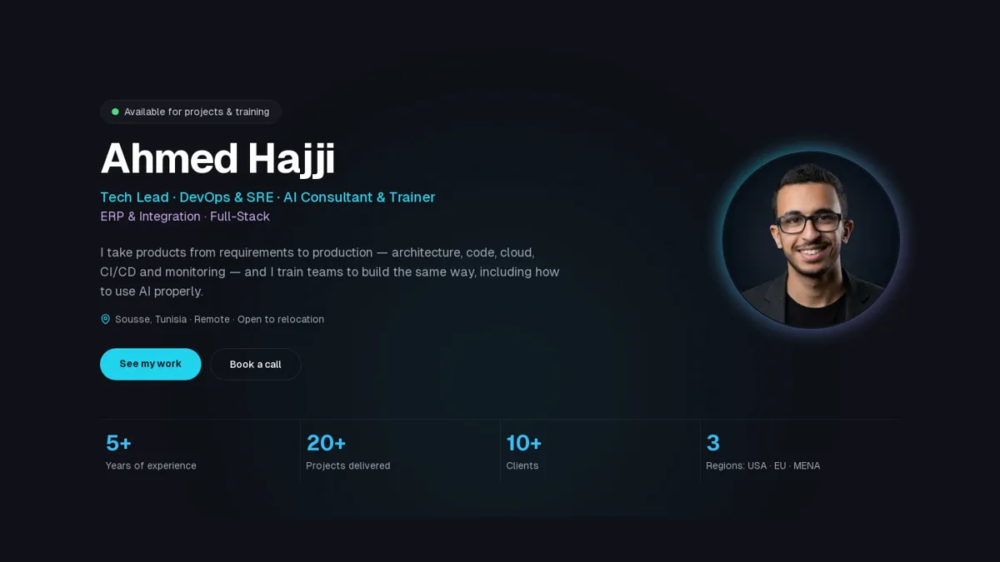
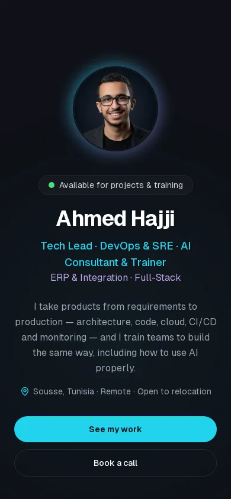

<div align="center">

# Ahmed Hajji — Professional Portfolio

**Built with Next.js 14 · Tailwind CSS · Framer Motion · Vercel**

[](https://ahmed-hajji-it.vercel.app)

</div>

---

## ✨ Sections

1. **Hero** — name, role, positioning, key stats
2. **Selected Work** — case studies: TieUp (co-founder & CTO), CabinAI, IZ Academy production hardening, Craft ERP (Odoo), client web apps
3. **Experience** — timeline from CTO to internship
4. **Training & Workshops** — AI and DevOps courses, teaching approach, AI certifications
5. **Services** — full-stack, DevOps/SRE & cloud, security & reliability audits, ERP/Odoo, AI integration & training
6. **Skills** — grouped toolbox
7. **About** — bio, education, certifications, languages, CV download
8. **Contact** — Formspree form + Calendly booking options

All copy lives in `lib/constants.ts`. Fully responsive from 360px, `prefers-reduced-motion` respected.

---

## 🛠️ Tech Stack

**Frontend**


**Deployment**


**Integrations**


---

## 🚀 Getting Started

### Prerequisites

- Node.js 20+
- npm or yarn

### Installation

```bash
git clone https://github.com/Ah-med-hajji/Portfolio.git
cd Portfolio
npm install
```

### Run Locally

```bash
npm run dev
```

Open [http://localhost:3000](http://localhost:3000) in your browser.

---

## 📸 Screenshots

| Desktop View | Mobile View |
|-------------|-------------|
|  |  |

---

## 🔗 Live Demo

👉 **[https://ahmed-hajji-it.vercel.app](https://ahmed-hajji-it.vercel.app)**

---

## 👤 Author

**Ahmed Hajji** — Tech Lead · DevOps & SRE · AI Consultant & Trainer

[🌐 Portfolio](https://ahmed-hajji-it.vercel.app) · [💼 LinkedIn](https://linkedin.com/in/hajjiahmed) · [📩 Email](mailto:ahmedhajji5401@gmail.com) · [📅 Book a Call](https://calendly.com/ahmedhajji5401)
